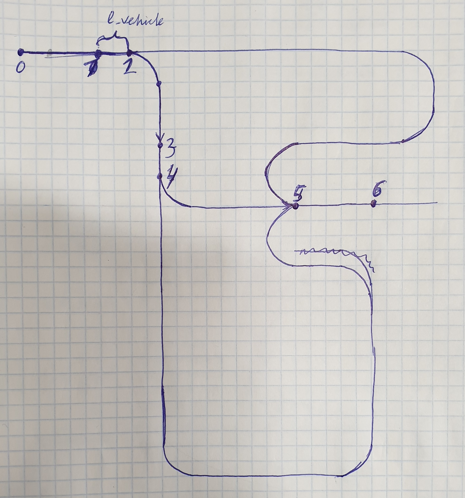

Route-planner

Карта для тестирования поиска маршрута
===

Еще один сценарий движения. Допустим мы преднамерено отправили автобус в тупик, 
чтобы он там зарядился или просто постоял. Заране известно, что невозможно ехать прямо. 
Так же на мцк происходит.
Итого три сценария:
- планирование маршрута до точки назначения, когда точка доступна.
- перепланирование маршрута когда точка назначения стала недоступна при 
движении прямо 
- планирование маршрута когда точка назначения недоступна при движении прямо

Варианты состояний
- можно проложить маршруту прямым ходом
- невозможно проложить маршрут не задействовав задний ход
- невозможно проложить маршрут из-за огромного удаления от карты

Необходимо выдавать решение с маршрутом в любом случаей, а так как данная инормация будет дополняться
информацией о доступности и направлении движения на участке, то behavior_core будет далее решать что делать.
Допустим он может попросить local_planner проложить траекторию разворота.

Как образом выдавать путевые точки в случае движения задним ходом, а затем передним? Отдельными пачками за раз,
по очереди?