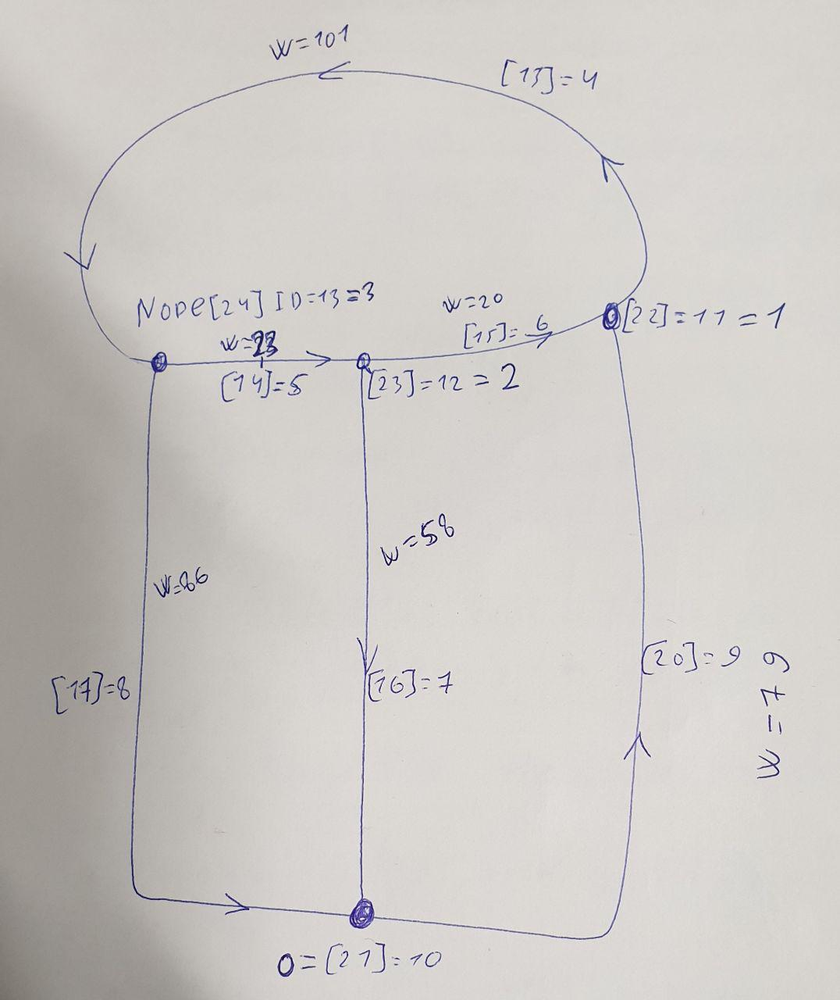
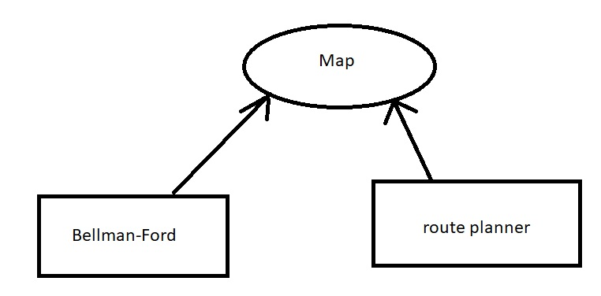

Route-planner

ROS обвязка:
## RoutePlannerCore class

Обеспечивает обмен данными с классом планирощика route_planner().

**Instance Variables**

*   pub_1 (name='/track', data_class=Track)
*   sub_1 (name='/vm_map', data_class=VectorMap)
*   sub_2 (name='/destination', data_class=Waypoint)
*   sub_2 (name='/current_pose', data_class=Waypoint)
*   rp (route_planner())
*   vm (VmMap())
*   destination (Waypoint())
*   current_pose (Waypoint())
*   route ([])
*   direct_velocity (float)
*   reverse_velocity (float)
*   is_set_current_pose (bool)
*   is_set_destination_pose (bool)
*   is_map_loaded (bool)

**Methods**

*   setup_route_planner (self)
    * Устанавливает скорости движения задним и передним ходом, которые учитываются при расчете времени в пути.
    
*   run (self)
    * Не позволяет ROS ноде самостоятельно завершить работ 
    
*   vector_map_callback (self, data)
    * Конвертирует ros сообщение с картой в формат обрабатываемый планировщиком и передает карту планировщику. Если 
    известны текущее местоположение и точка назначения, то вызывает self.generate_path().
    * **Parameters**:
        * data (route_planner/VectorMap.msg)
        
*   destination_callback (self, data)
    * Сравнивает текущую точку назначения с пришедшей. Если точка назначения изменилась, то записывает ее в планировщик.
    Если известна текущее положение и векторная карта загружена, то вызывает self.generate_path().
    * **Parameters**:
        * data (route_planner/Waypoint.msg)
        
*   current_pose_callback (self, data)
*   get_list_from_wp (self, wp)
*   generate_path (self)
*   msg2map (self, data)
*   compare_wps (self, destination, data)
*   publish_track (self)

Пакет реализован на Python и состоит из двух нод:
1) route_planner_node
2) vm_loader_node

Каждая из нод создает объекты своих почти одноименных классов RoutePlannerCore() и VMLoaderCore(), а затем выполняет
метод run(). Данные классы являются целиком и полностью ROS'овскими и нужны для применения объектов классов VMLoader()
и route_planner(), которые реализуют алгоритмы, а также конвертирования данных ROS-msgs и типов используемых в 
VMLoader() и route_planner().

                                                                                       
в Ubuntu. Для настройки добавить venv от системного python 2.7

Карта для тестирования поиска маршрута
===

Упрощенная карта площадки НАМИ
===

Еще один сценарий движения. Допустим мы преднамерено отправили автобус в тупик, 
чтобы он там зарядился или просто постоял. Заране известно, что невозможно ехать прямо. 
Так же на мцк происходит.
Итого три сценария:
- планирование маршрута до точки назначения, когда точка доступна.
- перепланирование маршрута когда точка назначения стала недоступна при 
движении прямо 
- планирование маршрута когда точка назначения недоступна при движении прямо

Варианты состояний
- можно проложить маршруту прямым ходом
- невозможно проложить маршрут не задействовав задний ход
- невозможно проложить маршрут из-за огромного удаления от карты

Необходимо выдавать решение с маршрутом в любом случаей, а так как данная инормация будет дополняться
информацией о доступности и направлении движения на участке, то behavior_core будет далее решать что делать.
Допустим он может попросить local_planner проложить траекторию разворота.

Каким образом выдавать путевые точки в случае движения задним ходом, а затем передним? Отдельными пачками за раз,
по очереди?

# TODO 
- как сломать ребро? (нужно удалить пару чисел, которая описывает ребро. Но тогда я потеряю
путевые точки на ребре. А машина находится на ребре как раз) Добавить поле "доступности" в структуру карты.
- изменить класс bellman-ford для вывода веса до узла +
- иначе хранить граф (https://habr.com/ru/post/112421/)
- Карта должна быть доступна как классу поиска по графу, так и планировищку движения. Первый ищет маршрут по графу, 
второй производит манипуляции с картой (загружает, меняет флаги). То есть карта должна храниться выше уровнем.
- не хватает setup.py and __init__.py

# Проблемы

- карта строится исходя из разметки, таким образом не везде можно повторить траекторию движения
- Какой угол требуется на path following ?
- из узла образуется несколько направлений движения. Если их не учитывать на этапе поиска
положения ТС, то на конечном этапе выдачи wps нужно будет постивать и добавить угол.
- для последней путевой точки узел является следующей точкой чтобы посчитать угол для последней
путевой точки
- как выдавать путевые точки с разной плотностью?
- рассмотреть случай, когда ближайший узел равен узлу назначения
- произвести опрос шасси для понимания минимального радиуса разворота машины
- расстояние считается на самом деле до путевой точки, а не до полосы движения
- можно ли одну карту использовать в обоих направлениях поиска?
- испытания с Тимофеем
- devel/setup.bash of workspace добавился только после того, как соответствующую строчку добавил в конце bash.rc

# Notes

- В Autoware сохраняется номер предыдущей путевой точки, чтобы быстрее найти следующую. 
Хотя на холодную так не получится. В общем в динамике можно сделать иначе
- Обязательно для ноды нужно сделать chmod u+x
- всегда будет приниматься точка назначения и если она изменилась, перестраивать положение.